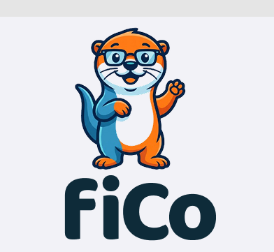

<p align="center">
  
</p>

# FiCo Gamification Architecture: Duolingo for Financial Sovereignty 🎮

> *"Making personal finance as engaging as learning a language on Duolingo, turning abstract 40-year compound interest into tangible, weekly micro-wins and bite-sized learnings."*

---

## 🧭 1. Vision & Core Philosophy

Traditional personal finance apps fail Gen Z and Millennials because they are:
1. **Anxiety-inducing:** Depressing red budgets and endless balance sheets that make users feel guilty for spending money.
2. **Cognitively exhausting:** 40-page insurance policies, complex tax codes, and opaque investment jargon.
3. **Temporally disconnected:** Saving for retirement in 40 years feels completely disconnected from daily life.

**FiCo adapts the proven behavioral psychology of Duolingo to finance:**
- **Micro-Habits over Heavy Lifts:** Transforming financial literacy into bite-sized, 2-minute weekly interactions.
- **Just-In-Time Micro-Learning ("Financial Snacks"):** 90-second myth-busters and interactive checkpoints sprinkled into the user journey.
- **Positive Reinforcement:** Rewarding smart cashflow choices and fee reductions rather than shaming discretionary spending.
- **Tangible Compounding:** Instantly converting everyday micro-savings (e.g. cycling to work, switching electricity tariffs) into real projected future wealth in the new **Altersvorsorgedepot**.
- **Agentic Automation:** Background AI agents do the heavy number-crunching, surfacing only actionable, rewarding decisions.

---

## ⚡ 2. The Core Habit Loop: Weekly Streaks

Unlike language learning, which thrives on daily repetition, **daily streaks in personal finance cause fatigue and churn**. Bank transactions, salaries, and investment cycles move on weekly and monthly intervals.

Therefore, FiCo introduces the **Weekly Streak (The Sunday Money Ritual)**.

```
       ┌────────────────────────────────────────────────────────┐
       │             THE SUNDAY MONEY RITUAL (2 min)            │
       │                                                        │
       │  1. Review Weekly Recap (Story/Slide Format)           │
       │  2. Bite-Sized Micro-Learning Snack (90 sec)          │
       │  3. Claim Weekly XP & Extend Streak Flame 🔥           │
       │  4. Agentic Micro-Quest Validation                     │
       │  5. Route Free Surplus via Cash Waterfall Engine       │
       └────────────────────────────────────────────────────────┘
```

### Streak Mechanics
- **The Threshold:** Minimum **1 meaningful check-in per week** (Friday to Sunday evening).
- **Streak Flame & Multipliers:**
  - `4-Week Streak (1 Month)` $\rightarrow$ **Bronze Flame** + Unlock "Fee Audit Tool"
  - `12-Week Streak (Quarter)` $\rightarrow$ **Silver Flame** + 1.25x XP Multiplier on Savings Challenges
  - `26-Week Streak (Half-Year)` $\rightarrow$ **Gold Flame** + Free Contract OCR Scan
  - `52-Week Streak (1 Year Sovereign)` $\rightarrow$ **Diamond Flame** + "Master of Compounding" Badge
- **Streak Freezes & Shields (No Pay-to-Win):**
  - Users do *not* buy streak freezes with real money.
  - Streak Freezes are **earned** through responsible financial behavior (e.g., maintaining an emergency fund, not touching savings, or completing a financial education micro-quiz).

---

## 📊 3. The "Weekly Money Wrapped" (Automated Recap)

Every Sunday afternoon, the `@fico/workers` engine generates an interactive, personalized **Weekly Story** (inspired by Spotify Wrapped and Duolingo Weekly Reports).

```
╔════════════════════════════════════════════════════════════════════════╗
║                      YOUR WEEKLY MONEY WRAPPED ⚡                       ║
║                                                                        ║
║  🔥 WEEK 14 STREAK ACTIVE! (+150 XP)                                   ║
║                                                                        ║
║  💰 CASHFLOW PULSE:                                                    ║
║     • Income received:       €1,250.00                                 ║
║     • Fixed costs paid:        €420.00                                 ║
║     • Discretionary spend:     €210.00 (within target!)                ║
║     • Free Surplus:            €620.00 ➔ Routed to Waterfall           ║
║                                                                        ║
║  🛡️ EMERGENCY SHIELD:                                                 ║
║     [██████████████████░░░░] 78% of 3-month target (+€150 this week)   ║
║                                                                        ║
║  🥊 BOSS DAMAGE REPORT (Lifetime Fees Avoided):                        ║
║     You deal €380 damage to "Allianz Gross Policy Monster"!            ║
║                                                                        ║
║  🌱 AGENTIC HABIT HIGHLIGHT:                                           ║
║     "You cycled 4 days instead of taking transit (€15.20 saved).      ║
║      Compounded into Altersvorsorgedepot = €27,360 at retirement!"     ║
╚════════════════════════════════════════════════════════════════════════╝
```

---

## 🤖 4. Agentic Integrations: Turning Everyday Choices into Compounding Wealth

FiCo leverages autonomous background agents that observe cross-domain data feeds and calculate their **long-term wealth impact**.

### A. Mobility: "Bike vs. Public Transit / Uber"
- **Data Hook:** AISP transaction monitoring (categorizing transport expenses like Bahn, BVG, Uber, Lime, or petrol) combined with optional mobility health/GPS APIs.
- **The Calculation:** 
  $$\text{Daily Transit Cost} = €3.80 \times 2 = €7.60$$
  If the user commutes by bicycle 3 days a week:
  $$\text{Monthly Savings} \approx €91.20$$
- **The Altersvorsorgedepot Projection:**
  The agent translates this into long-term wealth:
  > *"By biking 3x/week, you save €91/month. If our auto-sweep routes this into your **Altersvorsorgedepot** at 7% p.a. over 35 years, this single habit yields **€164,000+** at retirement!"*

### B. Energy & Smart Grid: Dynamic Tariffs (e.g., Tibber / Smart Meters)
- **Data Hook:** Smart meter consumption API or utility webhook.
- **The Action:** FiCo's Energy Agent detects energy usage patterns and off-peak charging.
- **The Quest:** *"Vampire Load Hunt"* — identifying continuous standby power draws (>100W at 3 AM).
  > *"Eliminating your 80W standby drain saves €210/year. That's €34,500 more in your Altersvorsorgedepot."*

### C. The Subscription Detective & Zombie Cleaner
- **Data Hook:** AISP recurring transaction classifier (`@fico/aisp/recurring-classifier`).
- **The Interaction:** The agent detects dual streaming subscriptions or forgotten trial periods.
- **One-Tap Execution:** Generates a cancellation letter and asks: *"Should we redirect this €17.99/mo to your Altersvorsorgedepot ETF plan?"*

---

## 🧠 5. Duolingo-Style Financial Checkpoints: Bite-Sized Micro-Learnings ("Financial Snacks")

Rather than forcing users through boring 30-minute academy videos, FiCo breaks essential financial literacy into **60–90 second interactive cards** ("Financial Snacks") that appear contextually throughout the app.

```
      ┌────────────────────────────────────────────────────────┐
      │  FINANCIAL SNACK #12 🍿                     +25 XP ⚡  │
      │                                                        │
      │  "Wait... what does REBALANCING an ETF actually mean?" │
      │                                                        │
      │  Imagine your portfolio is an RPG squad:              │
      │  ⚔️ 70% Global Equities (Attack)                      │
      │  🛡️ 30% Bonds / Money Market (Defense)                 │
      │                                                        │
      │  After a big market rally, your squad shifts to:       │
      │  ⚔️ 85% Attack / 🛡️ 15% Defense.                       │
      │                                                        │
      │  Your risk is now way higher than you wanted!          │
      │  👉 Rebalancing = selling a bit of what ran hot to     │
      │     buy the dip on what lagged. Automatically selling  │
      │     high and buying low without emotional FOMO.        │
      │                                                        │
      │  [ Quick Quiz: Test Your Understanding ➔ ]             │
      └────────────────────────────────────────────────────────┘
```

### Real-World Learning Modules (Sprinkled In Just-in-Time)

#### 🥪 Snack 1: The ETF Rebalancing Checkpoint
- **The Question:** *"Why should I care about rebalancing if stocks keep going up?"*
- **The Bite:** Explains how risk drift happens over time. In a multi-asset portfolio, equities grow faster than cash or bonds, subtly turning a moderate investor into an aggressive gambler right before a market dip. Rebalancing forces disciplined profit-taking.
- **The Quiz:** *"Your equity share spiked from 70% to 85% during a bull market. What does rebalancing do?"*
  - A) Double down on high-beta tech stocks *(Wrong! -5 XP)*
  - B) Sell 15% of equities to replenish the shield buffer *(Correct! +25 XP)*
  - C) Panic sell everything into checking account *(Wrong! -5 XP)*

#### 🥪 Snack 2: The Silent Wealth Killer — "How much does a 1.5% ETF / Fund Fee REALLY cost?"
- **The Myth:** *"A 1.5% management fee sounds tiny. What's 1.5 out of 100?"*
- **The Eye-Opener Math:**
  Over a 35-year investment horizon with €200/month at 7% gross return:
  $$\text{At 0.20\% TER (Clean ETF in Altersvorsorgedepot): } \approx \mathbf{€335,000}$$
  $$\text{At 1.80\% TER (Traditional Active Bank / Insurance Fund): } \approx \mathbf{€212,000}$$
  - **The Damage:** That innocent-sounding 1.6% fee delta devoured **€123,000+** — over **36% of your total lifetime wealth**!
- **Interactive Simulator:** A tactile slider where users drag the TER from 0.2% to 2.5% and watch the compound curve collapse in real time.

#### 🥪 Snack 3: Liability Demystified — "Do I really need a Privathaftpflicht? Why is Car Liability legally mandatory but Bicycle isn't?"
- **The Legal Reality (§ 823 BGB):** In Germany, you are personally liable for damages you cause with **100% of your current assets and all future earnings, for life, without limit!**
- **The Comparison:**
  | Dimension | Car Liability (*Kfz-Haftpflicht*) | Personal Liability (*Privathaftpflicht*) |
  | --- | --- | --- |
  | **Is it legally mandatory?** | **YES** (by law / *Pflichtversicherungsgesetz*) | **NO** (voluntary, but existential!) |
  | **Why the distinction?** | Cars have inherent operational danger (*Betriebsgefahr*) with massive kinetic energy. The state protects third-party victims. | Bicycles & pedestrians have lower statistical kinetic energy, so the state does not mandate a policy. |
  | **The Catastrophic Trap:** | If uninsured, the state seizes the car license plate immediately. | If you ride a bike, glance at your phone, and cause an ICE train or bus crash: **you owe €3,000,000+** out of pocket for life. |
- **The Takeaway:** A €3–€5/month Privathaftpflicht is the cheapest "anti-ruin shield" in the world. FiCo checks whether your policy includes modern net-tariff clauses (like gross negligence / *grobe Fahrlässigkeit* and loss of keys).

#### 🥪 Snack 4: The Altersvorsorgedepot Unpacked — "Why did Riester fail, and why is the new depot different?"
- **The Bite:** Old Riester plans legally forced providers to offer a 100% nominal capital guarantee. In a zero-interest era, providers were forced to park your money in negative-yielding bonds rather than equities! The new **Altersvorsorgedepot** drops this restrictive guarantee, letting young people harness 100% global equity compounding while still enjoying government matching and tax deferral.

---

## 🌳 6. The Financial Skill Tree: RPG Progression

Users progress along a visual **Skill Tree** structured into distinct Chapters:

```
[Chapter 1: The Foundation]
        │
        ├── 🛡️ Quest 1.1: Connect Bank (AISP) ─────────► [50 XP]
        ├── 📊 Quest 1.2: Categorize Fixed Costs ──────► [75 XP]
        └── 🏰 Quest 1.3: Build The Shield (Emergency) ─► [150 XP]
                    │
[Chapter 2: The Fee Slayer]
        │
        ├── 📄 Quest 2.1: Scan 1st Legacy Policy ──────► [100 XP]
        ├── 🥊 Quest 2.2: Defeat "Zillmerung Monster" ──► [200 XP]
        └── ⚖️ Quest 2.3: Net-Tariff Switch Check ─────► [250 XP]
                    │
[Chapter 3: The Wealth Engine]
        │
        ├── 🚀 Quest 3.1: Open Altersvorsorgedepot ────► [300 XP]
        ├── 🔄 Quest 3.2: First Automated Sweep ───────► [200 XP]
        └── 👑 Quest 3.3: Financial Sovereignty ───────► [500 XP]
```

### Character Titles / Badges
| Level | Title | Requirement |
| --- | --- | --- |
| **Lv 1** | Budget Novice | Connect first bank account via AISP |
| **Lv 2** | Shield Bearer | 1 Month fixed costs in Tagesgeld reserve |
| **Lv 3** | Debt Crusher | All high-interest debt (>4% APR) paid off |
| **Lv 4** | Fee Slayer | At least 1 legacy contract audited and unmasked |
| **Lv 5** | Depot Pioneer | Active Altersvorsorgedepot with automated monthly sweep |
| **Lv 6** | Net-Tariff Ninja | Core insurance converted to zero-commission net tariffs |
| **Lv 7** | Financial Sovereign | Full cashflow waterfall automated in equilibrium |

---

## 🤝 7. Cooperative Guilds (No Toxic Wealth Flexing)

Most finance leaderboards fail because **displaying net worth creates shame and toxic comparisons**. 

FiCo uses **Cooperative Financial Guilds**:
- **Team Quests:** A group of friends or colleagues forms a Guild (e.g., *"Stuttgart Founders Guild"*).
- **Collective Metrics:**
  - Total High-Interest Debt Eliminated by the Guild: *€14,800*
  - Total Hidden Broker Fees Avoided: *€89,200*
  - Combined Weekly Streak: *38 Weeks*
  - Financial Snacks Mastered: *142 Lessons Completed*
- **Team Rewards:** Unlocking group badges and shared milestone celebrations.

---

## 🛠️ 8. Technical Data Architecture

The gamification layer is fully decoupled from the core double-entry ledger to guarantee financial auditability:

```
┌─────────────────────────────────────────────────────────────┐
│                    Gamification Engine                      │
│      (Streaks, XP, Weekly Summaries, Quests, Badges)        │
└──────────────┬───────────────────────────────┬──────────────┘
               │                               │
               ▼                               ▼
    ┌────────────────────┐          ┌────────────────────┐
    │  @fico/ledger      │          │  @fico/aisp        │
    │  - Balance states  │          │  - Recurring costs │
    │  - Waterfall logic │          │  - Transaction tags│
    └────────────────────┘          └────────────────────┘
               │                               │
               └───────────────┬───────────────┘
                               │
                               ▼
                    ┌────────────────────┐
                    │  @fico/workers     │
                    │  Weekly Cron Jobs  │
                    │  Agent Integrations│
                    └────────────────────┘
```

### Prisma Schema Extension (Scaffold)
```prisma
model UserGamificationProfile {
  id                 String    @id @default(dbgenerated("gen_random_uuid()")) @db.Uuid
  userId             String    @unique @db.Uuid
  currentStreakWeeks Int       @default(0)
  longestStreakWeeks Int       @default(0)
  lastCheckInDate    DateTime? @db.Timestamptz(6)
  streakFreezeCount  Int       @default(1)
  totalXp            Int       @default(0)
  currentLevel       Int       @default(1)
  completedSnacks    Json      @default("[]")
  badges             Json      @default("[]")

  user User @relation(fields: [userId], references: [id], onDelete: Cascade)
}

model WeeklySummary {
  id              String   @id @default(dbgenerated("gen_random_uuid()")) @db.Uuid
  userId          String   @db.Uuid
  weekNumber      Int
  year            Int
  savingsTotal    Decimal  @db.Decimal(12, 2)
  feesAvoided     Decimal  @db.Decimal(12, 2)
  xpEarned        Int
  microHabitStory Json
  createdAt       DateTime @default(now()) @db.Timestamptz(6)

  user User @relation(fields: [userId], references: [id], onDelete: Cascade)
}

model FinancialSnack {
  id          String   @id @default(dbgenerated("gen_random_uuid()")) @db.Uuid
  slug        String   @unique @db.VarChar(100)
  category    String   @db.VarChar(50) // "INVESTING", "INSURANCE", "ALTERSVORSORGE", "HABITS"
  title       String   @db.VarChar(255)
  content     Json
  quiz        Json
  xpReward    Int      @default(25)
  createdAt   DateTime @default(now()) @db.Timestamptz(6)
}
```

---

## 🏁 Summary: Why This Wins Gen Z & Hackathons

1. **Emotional Connection:** Changes personal finance from an intimidating chore into an empowering personal RPG.
2. **Just-in-Time Literacy:** Delivers practical financial enlightenment (ETF rebalancing, TER drag, liability pitfalls) in 90-second snacks.
3. **Real Economic Impact:** Bridges the gap between micro-habits (cycling, smart power) and macro wealth (**Altersvorsorgedepot**).
4. **Sustainable Engagement:** Weekly cadence prevents notification fatigue while building lifelong financial habits.
