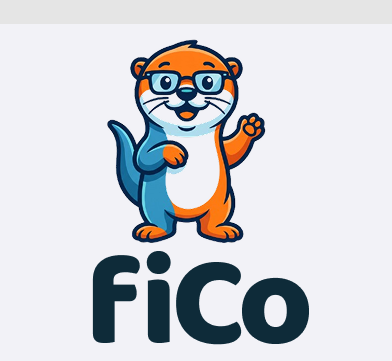

<div align="center">
  
  <h1>FiCo</h1>
  <p><strong>Autonomous Financial Ledger & Net-Tariff Orchestration Engine (FL-NTOE)</strong></p>
  <p><em>Transforming the dry, bureaucratic world of finance and insurance into an engaging, gamified journey for Gen Z and Millennials — powered by Germany's 2026 Altersvorsorgedepot reform.</em></p>
  <p><strong>Built for Founders Hackathon Stuttgart — November 7, 2026</strong></p>
</div>

<p align="center">
  <a href="https://github.com"></a>
  <a href="./user_stories.md"></a>
  <a href="./technical_overview.md"></a>
  <a href="./GAMIFICATION.md"></a>
  <a href="https://www.typescriptlang.org/"></a>
  <a href="https://nodejs.org/"></a>
  <a href="https://vitest.dev/"></a>
  <a href="https://www.bafin.de"></a>
</p>

---

## 💡 The Mission: Gamifying Wealth for Gen Z & Millennials

The world of German pensions and insurance (*Altersvorsorge*, *Lebensversicherung*, *BU*) is notoriously dry, opaque, and intimidating:
- **Bureaucracy & 40-Page PDFs:** Young savers are overwhelmed by insurance jargon and fine print.
- **Hidden Fees & Commission Traps:** Legacy products (Riester, Rürup, gross life insurance) silently eat up to **30–40% of returns** via front-loaded commissions (*Zillmerung*) and inflated annual TERs (>2–3%).
- **The Inaction Trap:** Because it feels boring and complicated, millions of young people postpone retirement planning, compounding the demographic pension crisis (*Rentenlücke*).

### 🎯 The Wedge: Germany's New *Altersvorsorgedepot* (2026)
The German pension reform brings a historic paradigm shift: the **Altersvorsorgedepot** (subsidized, tax-advantaged equity/ETF pension accounts with state matching and tax deferral). 

**FiCo turns this reform into the ultimate wake-up call and catalyst.**  
Instead of reading 40 pages of boring legal texts, users upload their existing policy or connect their bank account, and FiCo turns their financial health into an **interactive, gamified showdown**:
- **Legacy Fee Monster vs. Altersvorsorgedepot:** Watch your existing high-cost contract fight head-to-head against the new government-backed Altersvorsorgedepot.
- **The Shock Metric:** Instantly discover how many tens of thousands of Euros in fees you could rescue over 30–40 years by switching to the Altersvorsorgedepot and commission-free net tariffs (*Nettotarife*).

---

## 🎮 Gamification Core: How Users Experience FiCo

> 📖 **Deep Dive:** Read [GAMIFICATION.md](./GAMIFICATION.md) for full specs on our Duolingo-inspired habit loops, streak freezes, weekly recap stories, bite-sized micro-learnings, and agentic micro-savings formulas.  
> 📋 **Product Specification:** See [user_stories.md](./user_stories.md) for the core user stories and acceptance criteria.

```
               ┌────────────────────────┐
               │   Drop Dusty PDF /     │
               │   Connect Bank (AISP)  │
               └───────────┬────────────┘
                           │
                           ▼
          ╔══════════════════════════════════╗
          ║  BATTLE 1: "The Fee Boss Fight"  ║
          ║  Local OCR unmasks hidden costs  ║
          ║  (Zillmerung, ongoing TER fees)  ║
          ╚════════════┬═════════════════════╝
                       │
                       ▼
          ╔══════════════════════════════════╗
          ║   ARENA: Altersvorsorgedepot     ║
          ║         vs. Legacy Plan          ║
          ║  Interactive 40-year simulation  ║
          ║  "You reclaim €112,400 in fees!  ║
          ╚════════════┬═════════════════════╝
                       │
                       ▼
          ╔══════════════════════════════════╗
          ║   QUEST: Cashflow Waterfall      ║
          ║  Level 1: Shield (Emergency Run) ║
          ║  Level 2: Crusher (Debt Payoff)  ║
          ║  Level 3: Altersvorsorgedepot 🚀 ║
          ╚══════════════════════════════════╝
```

### 1. 🥊 Boss Fight: Unmask the Hidden Fee Monster
Users scan or upload their existing pension or insurance policy. FiCo’s local zero-cost heuristics tear through the fine print to isolate:
- Acquisition & sales commissions (*Abschlusskosten / Zillmerung*)
- Annual administrative fee drag (*Effektivkostenquote*)
- Break-even points and surrender penalties

### 2. ⚡ The Altersvorsorgedepot Arena (Showdown Simulator)
A visual side-by-side simulation:
- **Left Corner:** The legacy contract with high management fees, dragging future net wealth.
- **Right Corner:** The modern **Altersvorsorgedepot** + low-cost core ETF accumulation with state funding and tax perks.
- **The Level-Up Reward:** Users see in real-time how many years earlier they could retire or how much their monthly pension increases without paying a single Euro more out of pocket.

### 3. 🌊 Cashflow Waterfall Quests
Financial discipline, transformed into a level progression:
- **Level 1 — The Shield:** Automated 3-month emergency reserve (*Tagesgeld / Geldmarkt*) calculated directly from bank fixed costs.
- **Level 2 — Toxic Debt Crusher:** Wipes out any liabilities exceeding 4% APR.
- **Level 3 — The Wealth Engine:** Automatically streams free surplus cashflow directly into the Altersvorsorgedepot and long-term core wealth builder.

### 4. 🛡️ Net-Tariff Switch Without Kickbacks
When replacing outdated coverage, FiCo routes users to unbundled **net tariffs** (*Nettotarife*). No hidden commissions, no broker kickbacks (§ 48b VAG compliant), and complete transparency through fee-only advisory invoicing.

### 5. 🔥 Duolingo-Style Weekly Streaks & The Sunday Money Ritual
Daily streaks in finance cause fatigue; financial cycles move weekly and monthly. FiCo enforces a **1x per week minimal threshold**:
- **The Sunday Money Ritual (2 min):** Review automated cashflow, claim weekly XP, maintain the streak flame, and allocate free surplus.
- **Earned Streak Freezes:** Streak shields are unlocked through good financial milestones (e.g. maintaining the emergency fund), never bought with real cash.
- **Weekly Money Wrapped:** A Spotify/Duolingo-style story card summarizing weekly cashflow health, XP gained, and cumulative fee damage inflicted on legacy monsters.

### 6. 🤖 Agentic Cross-Domain Habits: "Bike vs. Transit" & Smart Energy
Autonomous background agents observe external data sources and calculate their real long-term compounding impact in the Altersvorsorgedepot:
- **"Bike instead of Transit" Agent:** Commuting by bike 3 days a week saves ~€91/month. FiCo projects: *Allocated to your Altersvorsorgedepot at 7% over 35 years = **€164,000+** at retirement!*
- **Smart Power Agent (Tibber / Smart Meters):** Detects vampire standby loads (>100W at night) and dynamic tariff off-peak savings.
- **Zombie Subscription Sweeper:** Detects forgotten SaaS/streaming subscriptions, drafting instant cancellation letters and redirecting the cashflow.

### 7. 🧠 Just-in-Time "Financial Snacks" (Micro-Learning)
90-second interactive learning checkpoints sprinkled contextually into the journey:
- **ETF Rebalancing:** Why portfolio drift turns moderate investors into accidental risk-takers without regular rebalancing.
- **The 1.5% Fee Eye-Opener:** How a 1.6% management fee difference silently destroys €123,000+ (over 36% of total wealth) over 35 years vs. a clean ETF.
- **Personal Liability Demystified:** Why car liability is legally mandatory under *Betriebsgefahr*, but personal liability is your most critical anti-ruin shield under § 823 BGB.

---

## ⚙️ Engineering & Architecture: Built for BaFin-Grade Reality

> 🛠️ **Deep Dive:** Read [technical_overview.md](./technical_overview.md) for the complete architectural blueprint, cross-domain sequence diagrams, bounded contexts, and failure domains.

Behind the engaging gamification layer lies an autonomous, enterprise-grade financial ledger and regulatory orchestration engine designed specifically for the German and European regulatory framework.

```
┌─────────────────────────────────────────────────────────────────────────────┐
│                             FiCo Edge API                                   │
│                        (Fastify / TypeScript)                               │
└──────┬───────────────────────┬───────────────────────────────┬──────────────┘
       │                       │                               │
       ▼                       ▼                               ▼
┌──────────────┐       ┌──────────────┐                ┌──────────────┐
│ Context A:   │       │ Context B:   │                │ Context C:   │
│ Open Finance │       │ Core Ledger  │                │ Policy & Net │
│ (@fico/aisp) │       │(@fico/ledger)│                │(@fico/policy)│
└──────┬───────┘       └──────┬───────┘                └──────┬───────┘
       │                      │                               │
       │                      ▼                               │
       │               ┌──────────────┐                       │
       │               │ Double-Entry │                       │
       │               │  OCC Ledger  │                       │
       │               └──────────────┘                       │
       │                      │                               │
       ▼                      ▼                               ▼
┌─────────────────────────────────────────────────────────────────────────────┐
│                      Regulatory Guards (@fico/regulatory)                   │
│  § 2 (2) Nr. 4 WpIG (No Stock Advice) | § 48b VAG | § 63 VVG Chasm Guard    │
└─────────────────────────────────────────────────────────────────────────────┘
                                      │
                                      ▼
                        ┌───────────────────────────┐
                        │ Worker Pool (@fico/workers│
                        │ BullMQ / Redis / Document │
                        └───────────────────────────┘
```

### Bounded Contexts

| Context | Package | Responsibility & Boundary |
| --- | --- | --- |
| **A — Open Finance Ingestion** | `@fico/aisp`, `@fico/workers` | PSD2/PSD3 read-only AISP bank sync, HMAC webhook authentication, recurring cashflow classifier. **No payment initiation (PISP) attack surface.** |
| **B — Core Financial Ledger** | `@fico/ledger` | High-precision append-only double-entry bookkeeping with Optimistic Concurrency Control (OCC) and deterministic cash waterfall algorithms. |
| **C — Policy / Net-Broker** | `@fico/policy` | Zero-cost local OCR heuristics, economic gatekeeper (Denial-of-Wallet defense), and net-tariff synchronization. |
| **D — Datasources Registry** | `@fico/datasources` | Canonical catalog of Open Finance (finAPI, Tink, wealthAPI) & finexpert.de Schnittstellen. |
| **Regulatory Firewalls** | `@fico/regulatory` | Programmatic regulatory invariants (WpIG, VAG, GewO, VVG) compiled directly into code. |

---

## ⚖️ Built-in Regulatory Compliance (German / EU Fintech Law)

Unlike generic AI wrappers, FiCo enforces hard regulatory invariants at the core:

1. **§ 2 Abs. 2 Nr. 4 WpIG (No Illegal Investment Advice):**
   - The copilot acts strictly as an analytical tool, **never** recommending specific ISINs or single stocks.
   - Any query attempting to solicit specific stock or ETF picks (e.g., *"Should I buy A1JX52?"*) is intercepted by the semantic firewall (`evaluateInvestmentQuery`) and redirected to macro-allocation educational guidance or execution-only broker deep-links (Trade Republic, Scalable, ING).
2. **§ 48b VAG & § 34d GewO (Rebate Ban & Fee-Only Transparency):**
   - No opaque kickback tables or commission sharing.
   - Transparent advisory fee invoices only (`advisory_fee_invoices`).
3. **Underwriting Chasm Guard (§ 63 VVG):**
   - A finite state machine ensures legacy policies can never be cancelled until the new net-tariff or Altersvorsorgedepot account is cryptographically verified as `POLICY_ISSUED`.
4. **Denial-of-Wallet Circuit Breakers:**
   - Free-tier users and uneconomic documents (e.g. low-premium liability or grocery receipts) are intercepted locally via regex heuristics before reaching paid AI/OCR APIs.

---

## 📂 Monorepo Structure

```
packages/
├── aisp/         # finAPI + Tink + wealthAPI AISP connectors (read-only), HMAC, classifier
├── datasources/  # Canonical registry: Open Finance + all finexpert.de/schnittstellen
├── api/          # High-performance Fastify edge API (synchronous, lightweight)
├── db/           # Prisma schema & PostgreSQL migrations (double-entry ledger models)
├── ledger/       # Append-only double-entry OCC engine + deterministic cash waterfall
├── policy/       # OCR heuristics, economic gate, finexpert Schnittstellen clients
├── regulatory/   # WpIG investment firewall, VAG commission invariants, VVG state machine
└── workers/      # BullMQ background workers for async document & upstream operations
```

### Datasources & Integrations

| ID | Source | Role |
| --- | --- | --- |
| `FINAPI` / `TINK` | Open Finance AISP | Bank accounts & transactions (no PISP) |
| `WEALTHAPI` | Wealth & Custody | Depot snapshots |
| `FINEXPERT_REST` | [finexpert Schnittstellen](https://www.finexpert.de/schnittstellen/) | REST API (kunden, risikocheck) |
| `BLAU_DIREKT` | finexpert | Native pool two-way sync / Abschlussstrecke |
| `BCA` | finexpert | BCA Bestand / CRM / Dokumente |
| `FRANKE_BORNBERG` | finexpert | fb>vertragscheck synopsis |
| `TAA` | finexpert | Tarifrechner → Beratungskonzept |
| `MVP` | finexpert | Maklerverwaltungsprogramm sync |

`GET /v1/datasources` returns runtime config status for all connected sources.

---

## 🚀 Quick Start (Hackathon Evaluators & Devs)

### Prerequisites
- Node.js >= 20
- pnpm >= 9
- Docker & Docker Compose

### 1. Environment & Database Setup
```bash
# Clone the repository
git clone https://github.com/your-org/fico.git
cd FiCo

# Create environment configuration
cp .env.example .env

# Start PostgreSQL and Redis
docker compose up -d
```

### 2. Install Dependencies & Migrate
```bash
# Install monorepo dependencies
pnpm install

# Generate Prisma client and run database migrations
pnpm db:generate
pnpm db:migrate
```

### 3. Run the Test Suite
All core engines (Ledger, Waterfall, Regulatory Guards, Economic Gate, Datasources) are verified with unit and invariant test suites:
```bash
pnpm test
```

### 4. Launch the Edge API & Workers
```bash
# In terminal 1: Start API server (port 3000)
pnpm dev:api

# In terminal 2: Start background workers
pnpm dev:workers
```

---

## 🧪 Interactive API Walkthrough

Once the API is running, test the core endpoints directly:

### 1. The Altersvorsorgedepot Waterfall Quest
Simulate an automated cash allocation check (Emergency Reserve -> Debt Payoff -> Wealth Engine):
```bash
curl -X POST http://localhost:3000/v1/ledger/waterfall \
  -H "Content-Type: application/json" \
  -d '{
    "fixedCostSumLookback": 6000,
    "targetBufferMonths": 3,
    "accounts": [
      { "type": "CHECKING", "balanceAmount": 2500 },
      { "type": "SAVINGS", "balanceAmount": 4000 },
      { "type": "CREDIT_CARD", "balanceAmount": 0, "aprPct": 0 }
    ]
  }'
```
*Result: Emergency reserve met! Surplus is routed to the **Altersvorsorgedepot Wealth Engine**.*

### 2. § 2 Abs. 2 Nr. 4 WpIG Regulatory Firewall
Verify that illegal investment advisory queries are intercepted:
```bash
curl -X POST http://localhost:3000/v1/copilot/query \
  -H "Content-Type: application/json" \
  -d '{ "query": "Should I sell my Allianz pension and buy A1JX52?" }'
```
*Result: HTTP 422 `WPIG_SPECIFIC_SECURITY_BLOCK` — specific security advice blocked; macro educational allocation preserved.*

---

## 🏆 Hackathon Team & Vision

**Event:** Founders Hackathon Stuttgart — November 7, 2026  
**Vision:** Demystify personal finance for the next generation. By combining the 2026 Altersvorsorgedepot reform with engaging gamification and uncompromised regulatory engineering, FiCo empowers Gen Z and Millennials to reclaim control of their financial future.

---
*FiCo — Autonomous Financial Ledger & Net-Tariff Orchestration Engine.*
