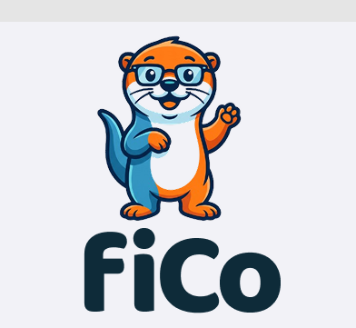

  

# FiCo — Core User Stories 📋

> **Target Audience:** Gen Z & Millennials navigating pensions and insurance in Germany.  
> **Mission:** Transforming dry, bureaucratic financial products into an engaging, gamified journey anchored around Germany's 2026 Altersvorsorgedepot reform.

---

## 👤 Persona Directory

* **Sarah (Career Starter, 24):** Signed a private pension or insurance policy via a broker/bank upon starting her first job. Overwhelmed by jargon and 40-page contract PDFs; wants transparency without guilt.
* **Daniel (Gen Z Saver, 22):** Active on neo-brokers (Trade Republic, Scalable), passionate about low-cost ETFs. Wants to know whether the new state-subsidized Altersvorsorgedepot beats his existing plans.
* **Stefan (Salaried Employee, 31):** Struggles with consistent budgeting. Wants an autonomous, prioritized cashflow system that builds an emergency cushion before wealth accumulation.

---

## 🥊 US-01: Fee Boss Fight (Policy Upload & Cost Analysis)

**As** Sarah (a career starter with an existing contract),  
**I want to** upload my existing pension or insurance policy documents as a PDF,  
**So that** hidden acquisition commissions (*Zillmerung*) and ongoing effective costs (*Effektivkosten*) are automatically unmasked without reading through 40 pages of legal fine print.

### Acceptance Criteria:
1. **Local Document Analysis (OCR / Regex Heuristics):** The system automatically extracts acquisition fees (*Abschluss- und Vertriebskosten*), ongoing administrative cost ratios (*Effektivkostenquote*), and annual management fees.
2. **Cumulative Lifetime Fee Breakdown:** A clear, interactive visual shows the total cumulative fees charged over the contract's entire investment horizon (30–40 years).
3. **Denial-of-Wallet & Document Guard:** Uneconomic documents (e.g. low-premium liability) or non-insurance files (e.g. invoices, receipts) are intercepted locally via regex heuristics before reaching expensive paid cloud APIs.

#### 🔗 Technical Implementation Mapping:
- **Module:** `@fico/policy` (`ocr-heuristics.ts`, `economic-gate.ts`, `finexpert-schnittstellen.ts`)
- **Database Model:** `InsurancePolicy`, `PolicyCostStructure` (`COMMISSION_ZILLMERIZED`, `GROSS_STANDARD`, `NET_HONORAR`)

---

## ⚡ US-02: Altersvorsorgedepot Showdown Simulator

**As** Daniel (a Gen Z saver),  
**I want to** directly benchmark my existing legacy contract against the new government-backed Altersvorsorgedepot (ETF-based),  
**So that** I can see exactly how much capital and monthly pension income I gain by switching to modern net-tariffs.

### Acceptance Criteria:
1. **Side-by-Side 40-Year Simulation:** Direct comparative projection of the legacy gross contract vs. the tax-advantaged Altersvorsorgedepot (assuming identical monthly contributions and asset class returns).
2. **"Shock Metric" Display:** Clear, gamified presentation of total wealth reclaimed (e.g., *"You rescue €112,400 in fees from the Fee Monster!"*).
3. **Retirement Age & Pension Delta:** Explicit projection showing either:
   - How many years earlier the user can retire with equal capital, OR
   - The increase in expected monthly retirement payout at the same out-of-pocket contribution.

#### 🔗 Technical Implementation Mapping:
- **Module:** `@fico/ledger` & `app/src/demo/DemoPanel.tsx`
- **Regulatory Gate:** `@fico/regulatory/wpig-guard.ts` (ensures macro-allocation comparisons without illegal single-stock / ISIN recommendations)

---

## 🌊 US-03: Cashflow Waterfall Quests

**As** Stefan (a salaried employee),  
**I want** my surplus monthly income to be distributed automatically according to strict financial priorities,  
**So that** my emergency buffer is fully funded first, high-interest debt is eliminated second, and only then is capital routed into my Altersvorsorgedepot.

### Acceptance Criteria:
1. **Level 1 (The Shield — Emergency Reserve):** Automatically calculates 3 months of fixed expenses from bank data (AISP) and routes 100% of available cash surplus to a risk-free *Tagesgeld* / money market reserve until the deficit is zero.
2. **Level 2 (The Crusher — Toxic Debt Payoff):** Once the emergency shield is fully funded, automatically flags and directs surplus capital to pay down liabilities with APR > 4.0%.
3. **Level 3 (The Wealth Engine — Altersvorsorgedepot):** Once emergency reserves are met and toxic debt is eliminated, automatically directs all remaining free cashflow to the long-term Altersvorsorgedepot / core ETF accumulator.

#### 🔗 Technical Implementation Mapping:
- **Module:** `@fico/ledger` (`waterfall.ts`, `evaluateWaterfall`)
- **API Endpoint:** `POST /v1/ledger/waterfall`
- **Output States:** `FILL_EMERGENCY_RESERVE` | `PAY_HIGH_INTEREST_DEBT` | `ALLOCATE_TO_WEALTH_ENGINE`

---
*FiCo — Transforming financial literacy and pension sovereignty for the next generation.*
