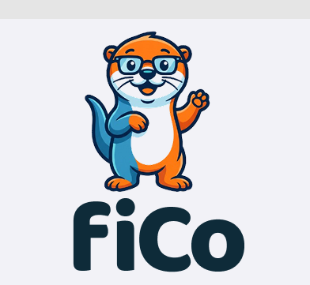
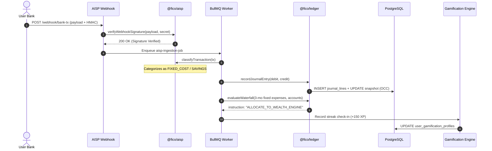
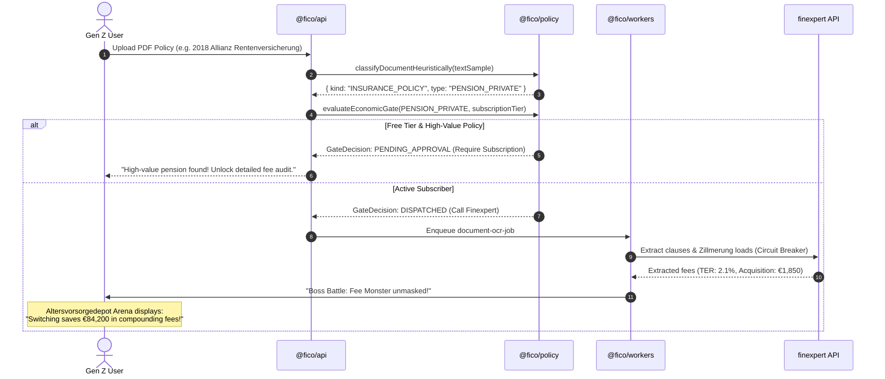
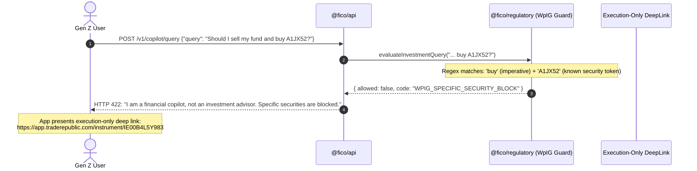

<p align="center">
  
</p>

# FiCo — Complete Technical Architecture & System Overview 🛠️

> **Autonomous Financial Ledger & Net-Tariff Orchestration Engine (FL-NTOE)**  
> *Architectural Blueprint, Bounded Contexts, Data Flows, and Regulatory Engineering.*

---

## 📑 Table of Contents
1. [Architectural Philosophy & Core Principles](#1-architectural-philosophy--core-principles)
2. [High-Level System Topology](#2-high-level-system-topology)
3. [The Bounded Contexts](#3-the-bounded-contexts)
   - [Context A: Open Finance & AISP Ingestion (`@fico/aisp`)](#context-a-open-finance--aisp-ingestion-ficoaisp)
   - [Context B: Core Financial Ledger (`@fico/ledger`)](#context-b-core-financial-ledger-ficoledger)
   - [Context C: Policy & Net-Broker Engine (`@fico/policy`)](#context-c-policy--net-broker-engine-ficopolicy)
   - [Context D: Regulatory Invariants & Guards (`@fico/regulatory`)](#context-d-regulatory-invariants--guards-ficoregulatory)
   - [Context E: Datasources Registry & Integration Mesh (`@fico/datasources`)](#context-e-datasources-registry--integration-mesh-ficodatasources)
4. [Cross-Domain Data Flows (Sequence Diagrams)](#4-cross-domain-data-flows-sequence-diagrams)
   - [Flow 1: Bank Transaction Ingestion ➔ Cash Waterfall ➔ Gamification Level-Up](#flow-1-bank-transaction-ingestion--cash-waterfall--gamification-level-up)
   - [Flow 2: Policy Upload ➔ Fee Boss Fight ➔ Altersvorsorgedepot Arena](#flow-2-policy-upload--fee-boss-fight--altersvorsorgedepot-arena)
   - [Flow 3: User Copilot Query ➔ § 2 Abs. 2 Nr. 4 WpIG Firewall](#flow-3-user-copilot-query---2-abs-2-nr-4-wpig-firewall)
5. [Storage Architecture & Prisma Schema (`@fico/db`)](#5-storage-architecture--prisma-schema-ficodb)
6. [Asynchronous Workers & Concurrency Limits (`@fico/workers`)](#6-asynchronous-workers--concurrency-limits-ficoworkers)
7. [Edge API Service (`@fico/api`)](#7-edge-api-service-ficoapi)
8. [Failure Domains & Fault Tolerance](#8-failure-domains--fault-tolerance)

---

## 1. Architectural Philosophy & Core Principles

FiCo is engineered using strict **Domain-Driven Design (DDD)** and European fintech compliance invariants:

1. **Separation of Ledger Truth from Presentation:**  
   The double-entry ledger is append-only, mathematically balanced, and protected by Optimistic Concurrency Control (OCC). The gamification layer (XP, streaks, quests) reads snapshots but can *never* mutate ledger balances directly.
2. **Zero-Trust External I/O:**  
   External HTTP network calls (banking APIs, OCR engines, LLMs) **never** run inside database transactions or API edge request threads. All outbound I/O is dispatched asynchronously to dedicated BullMQ worker queues with circuit breakers.
3. **Compliance by Design (German / EU Fintech Law):**  
   Regulatory constraints (§ 2 Abs. 2 Nr. 4 WpIG, § 48b VAG, § 63 VVG) are not afterthoughts or prompt instructions; they are compiled programmatic firewalls with unit-tested zero-tolerance policies.
4. **Denial-of-Wallet Defense:**  
   Multi-modal OCR and LLM reasoning are guarded by zero-cost local regex heuristics and economic gates before hitting external paid cloud APIs.

---

## 2. High-Level System Topology

```
                                 ┌────────────────────────┐
                                 │      Web / Mobile      │
                                 │    Gamified Client     │
                                 └───────────┬────────────┘
                                             │ HTTP / TLS
                                             ▼
┌────────────────────────────────────────────────────────────────────────────────────────┐
│                                    @fico/api                                           │
│                       Fastify Edge API (Low-Latency Router)                            │
│                                                                                        │
│   GET /health                 POST /v1/copilot/query       POST /v1/ledger/waterfall   │
│   GET /v1/datasources         GET /v1/aisp/sca-health      POST /v1/policy/economic-gate│
└────────────┬───────────────────────────────┬───────────────────────────────┬───────────┘
             │                               │                               │
             ▼                               ▼                               ▼
  ┌─────────────────────┐         ┌─────────────────────┐         ┌─────────────────────┐
  │  @fico/regulatory   │         │    @fico/ledger     │         │ @fico/datasources   │
  │ • WpIG Advice Guard │         │ • Double-Entry OCC  │         │ • finAPI / Tink     │
  │ • VAG Invariant Chk │         │ • Waterfall Engine  │         │ • wealthAPI         │
  │ • VVG Chasm Guard   │         │ • Arbitrary Decimals│         │ • finexpert catalog │
  └─────────────────────┘         └──────────┬──────────┘         └──────────┬──────────┘
                                             │                               │
                                             ▼                               ▼
┌────────────────────────────────────────────────────────────────────────────────────────┐
│                                   PostgreSQL 16                                        │
│                 @fico/db (Prisma ORM with Multi-Tenant Row Security)                   │
│                                                                                        │
│   • users                     • bank_consents             • accounts                   │
│   • transactions              • journal_entries           • journal_lines              │
│   • balance_snapshots         • insurance_policies        • policy_switch_cases        │
│   • user_gamification_profiles• weekly_summaries          • audit_logs                 │
└────────────────────────────────────────────┬───────────────────────────────────────────┘
                                             │
                        Redis Pub/Sub & Job Queue (BullMQ)
                                             │
                                             ▼
┌────────────────────────────────────────────────────────────────────────────────────────┐
│                                  @fico/workers                                         │
│                      Asynchronous Workload & Agentic Engine                            │
│                                                                                        │
│   [aisp-ingestion-queue]      [document-ocr-queue]        [agentic-habits-queue]       │
│   • FinAPI / Tink Ingestion   • Local SIMD / Tesseract    • Bike vs. Transit Tracker   │
│   • HMAC Verification         • Finexpert Clause Synop.   • Smart Grid / Tibber Parser │
│   • Recurring Classifier      • Max Concurrency = RAM/256 • Weekly Recap Generator     │
└────────────────────────────────────────────────────────────────────────────────────────┘
```

---

## 3. The Bounded Contexts

### Context A: Open Finance & AISP Ingestion (`@fico/aisp`)

**Purpose:** Connects to bank feeds (via PSD2/PSD3 providers like finAPI, Tink) in read-only mode, processes incoming transactions, and calculates recurring cashflows.

- **Adapter Abstraction (`adapter.ts`):** Unified interface for banking providers (`OpenFinanceAispAdapter`). Supports transaction retrieval, balance queries, and consent lifecycle.
- **HMAC Webhook Guard (`hmac.ts`):** Verifies incoming bank webhooks with `HMAC-SHA256` signatures against shared secrets. Validates timestamps against a 300-second replay window.
- **Recurring Transaction Classifier (`recurring-classifier.ts`):** Analyzes transaction descriptions, intervals, and amounts to categorize cashflows into:
  - `INCOME` (Salary, dividends)
  - `FIXED_COST` (Rent, electricity, insurance, streaming subscriptions)
  - `VARIABLE_SPEND` (Groceries, dining, discretionary)
  - `SAVINGS_INVESTMENT` (Depot transfers, Altersvorsorgedepot sweeps)
  - `DEBT_SERVICE` (Loan repayments, credit card payoff)
- **Strong Customer Authentication Health (`sca-lifecycle.ts`):** Enforces European PSD2 90-day consent limits. Emits proactive re-authentication prompts (`HEALTHY`, `NEEDS_REAUTH`, `EXPIRING_SOON`).

---

### Context B: Core Financial Ledger (`@fico/ledger`)

**Purpose:** The single source of mathematical and financial truth. Enforces double-entry bookkeeping and deterministic cashflow distribution.

#### 1. Double-Entry Invariants (`double-entry.ts`)
- **Mathematical Balance:** Every journal entry must satisfy:
  $$\sum \text{Debits} = \sum \text{Credits}$$
- **Arbitrary Precision Arithmetic (`money.ts`):** Powered by `big.js`. Avoids IEEE 754 floating-point rounding errors (e.g. `0.1 + 0.2 !== 0.3`).
- **Optimistic Concurrency Control (OCC):** Prevents race conditions during concurrent balance updates. Every account has an `AccountBalanceSnapshot` with a strictly incrementing `version` integer:
  ```sql
  UPDATE account_balance_snapshots
  SET balance_amount = :newBalance, version = version + 1
  WHERE account_id = :id AND version = :currentVersion;
  ```
  If another transaction updated the snapshot concurrently, the write returns 0 affected rows, triggering an automatic transactional retry.

#### 2. Deterministic Cash Waterfall (`waterfall.ts`)
Calculates the user's automated capital distribution order without human bias or broker kickback incentives:

```
[Incoming Net Cashflow]
           │
           ▼
┌──────────────────────────────────────┐
│  STEP 1: Target Emergency Buffer?    │
│  Target = 3 × Monthly Fixed Expenses │
└──────────────────┬───────────────────┘
                   │
         NO ───────┴─────── YES
         │                   │
         ▼                   ▼
┌──────────────────┐   ┌──────────────────────────────────────┐
│  INSTRUCTION 1:  │   │  STEP 2: High-Interest Debt Present? │
│  FILL EMERGENCY  │   │  Any loan/credit card > 4.0% APR?    │
│     RESERVE      │   └──────────────────┬───────────────────┘
└──────────────────┘                      │
                                NO ───────┴─────── YES
                                │                   │
                                ▼                   ▼
                       ┌──────────────────┐   ┌──────────────────┐
                       │  INSTRUCTION 3:  │   │  INSTRUCTION 2:  │
                       │   ALLOCATE TO    │   │  PAY OFF HIGH-   │
                       │  WEALTH ENGINE   │   │  INTEREST DEBT   │
                       │(Altersvorsorge)  │   └──────────────────┘
                       └──────────────────┘
```

---

### Context C: Policy & Net-Broker Engine (`@fico/policy`)

**Purpose:** Audits insurance and retirement policies, unmasks hidden fee loads (*Zillmerung*), and safely orchestrates switches to unbundled net tariffs.

- **Zero-Cost OCR Heuristics (`ocr-heuristics.ts`):** Evaluates incoming document text using regex heuristics *before* invoking paid multi-modal OCR APIs:
  - Classifies document into `INSURANCE_POLICY`, `NON_INSURANCE`, or `AMBIGUOUS`.
  - Determines policy type (`BU_DISABILITY`, `PENSION_BASE`, `PENSION_PRIVATE`, `PROPERTY_CASUALTY`, etc.).
- **Economic Gate & Denial-of-Wallet Guard (`economic-gate.ts`):**
  - High-value policies (`PENSION_BASE`, `BU_DISABILITY`, `PRIVATE_HEALTH`) are unlocked for paid deep analysis (`finexpert`) only for subscribed users.
  - Low-value P&C documents (`PROPERTY_CASUALTY`, `PET_HEALTH`) are diverted to static GDV checklists (`SKIPPED_UNECONOMIC`), saving costly API credits.
  - Non-insurance documents are immediately rejected (`REJECTED`).
- **Resilient Upstream Client (`circuit-breaker.ts`, `finexpert-client.ts`, `finexpert-schnittstellen.ts`):**
  - Wrapped in a 3-state circuit breaker (`CLOSED` $\rightarrow$ `OPEN` $\rightarrow$ `HALF-OPEN`).
  - Exponential backoff with jitter prevents thundering herd failures against insurance vendor APIs.

---

### Context D: Regulatory Invariants & Guards (`@fico/regulatory`)

**Purpose:** Hard-coded compliance boundaries adhering to German and European fintech regulations.

#### 1. § 2 Abs. 2 Nr. 4 WpIG Firewall (`wpig-guard.ts`)
- **The Rule:** An automated copilot is legally prohibited from providing individual investment advice (*Anlageberatung*) without a full WpIG license.
- **The Implementation:** Intercepts user queries using regular expressions for ISO 6166 ISINs, German WKNs, and retail ticker symbols (`A1JX52`, `VWCE`, `EUNL`, `SPY`, etc.) combined with transactional imperatives (`buy`, `sell`, `kaufen`, `umschichten`).
- **The Interception:** Returns HTTP 422 `WPIG_SPECIFIC_SECURITY_BLOCK`. Redirects the user to general macro-asset allocation education or provides **execution-only deep links** (Trade Republic, Scalable Capital, ING) where the user must execute manually.

#### 2. § 48b VAG & § 34d GewO Fee Transparency (`vag-invariants.ts`)
- **The Rule:** The German Insurance Supervision Act (§ 48b VAG) prohibits commission pass-through kickbacks (*Provisionsabgabeverbot*).
- **The Implementation:** FiCo’s database schema contains **zero broker commission sharing tables**. All revenue is modeled strictly through fee-only advisory invoicing (`advisory_fee_invoices`), ensuring complete structural neutrality.

#### 3. Underwriting Chasm Protection (§ 63 VVG / `underwriting-chasm.ts`)
- **The Rule:** If a user cancels a legacy disability or health policy before new coverage is approved, a pre-existing condition could leave them permanently uninsured (*Underwriting Chasm*).
- **The Implementation:** A strict Finite State Machine (FSM):
  ```
  DRAFT ➔ SYNOPSIS_COMPLETE ➔ APPLICATION_SUBMITTED ➔ UNDERWRITING 
  ➔ POLICY_ISSUED ➔ CANCELLATION_ALLOWED ➔ CANCELLED
  ```
  The status `CANCELLATION_ALLOWED` is mathematically impossible to reach unless the replacement policy reaches `POLICY_ISSUED`.

---

### Context E: Datasources Registry & Integration Mesh (`@fico/datasources`)

**Purpose:** Serves as the canonical catalog and runtime registry for Open Finance banking feeds, wealth custody depots, insurance broker pool interfaces, and net-tariff partners.

| ID | Category | Provider / Interface | Role in Architecture |
| --- | --- | --- | --- |
| `FINAPI` | Open Finance AISP | finAPI GmbH | German PSD2/PSD3 banking aggregation (read-only) |
| `TINK` | Open Finance AISP | Tink AB (Visa) | Pan-European multi-banking aggregation |
| `WEALTHAPI` | Custody & Depot | wealthAPI GmbH | Direct securities depot & portfolio valuation |
| `FINEXPERT_REST` | Policy & Risk | [finexpert.de](https://www.finexpert.de/schnittstellen/) | Customer sync and digital risk-check questionnaires |
| `BLAU_DIREKT` | Broker Pool | blau direkt GmbH | Native broker pool two-way sync & Abschlussstrecke |
| `BCA` | Broker Pool | BCA AG | Inventory, CRM, and contract document synchronization |
| `FRANKE_BORNBERG` | Policy Analysis | Franke und Bornberg | `fb>vertragscheck` automated clause comparison |
| `TAA` | Tarifrechner | finexpert TAA | Automated tariff comparison ➔ Beratungskonzept |
| `MVP` | Management | GDV / BiPRO | Broker management system (Maklerverwaltungsprogramm) |
| `NET_TARIFFS` | Fee-Only Broker | HonorarKonzept & con.fee | Commission-free net products (*Nettoprodukte*) |

All integrations expose health and configuration status via `GET /v1/datasources`.

---

## 4. Cross-Domain Data Flows (Sequence Diagrams)

### Flow 1: Bank Transaction Ingestion ➔ Cash Waterfall ➔ Gamification Level-Up



---

### Flow 2: Policy Upload ➔ Fee Boss Fight ➔ Altersvorsorgedepot Arena



---

### Flow 3: User Copilot Query ➔ § 2 Abs. 2 Nr. 4 WpIG Firewall



---

## 5. Storage Architecture & Prisma Schema (`@fico/db`)

The relational database is normalized and enforces financial integrity constraints:

```
┌────────────────────┐          ┌────────────────────┐
│       users        │ 1      * │   bank_consents    │
│────────────────────│──────────│────────────────────│
│ id (UUID, PK)      │          │ id (UUID, PK)      │
│ email              │          │ user_id (FK)       │
│ subscription_tier  │          │ consent_status     │
│ created_at         │          │ sca_valid_until    │
└─────────┬──────────┘          └────────────────────┘
          │ 1
          │
          ├───────────────────────────────────────────────────────┐
          │ *                                                     │ *
┌─────────▼──────────┐          ┌────────────────────┐  ┌─────────▼──────────┐
│      accounts      │ 1      * │  journal_entries   │  │ insurance_policies │
│────────────────────│──────────│────────────────────│  │────────────────────│
│ id (UUID, PK)      │          │ id (UUID, PK)      │  │ id (UUID, PK)      │
│ user_id (FK)       │          │ user_id (FK)       │  │ user_id (FK)       │
│ account_type       │          │ status (POSTED)    │  │ policy_type        │
│ balance_amount     │          │ posted_at          │  │ cost_structure     │
│ currency (EUR)     │          └─────────┬──────────┘  │ annual_premium     │
└─────────┬──────────┘                    │ 1           └─────────┬──────────┘
          │ 1                             │                       │ 1
          │                               ▼ *                     │
          │ 1                   ┌────────────────────┐            │ *
┌─────────▼──────────┐          │   journal_lines    │  ┌─────────▼──────────┐
│ balance_snapshots  │          │────────────────────│  │policy_switch_cases │
│────────────────────│          │ id (UUID, PK)      │  │────────────────────│
│ id (UUID, PK)      │          │ entry_id (FK)      │  │ id (UUID, PK)      │
│ account_id (FK)    │          │ account_id (FK)    │  │ current_policy_id  │
│ balance_amount     │          │ debit_amount       │  │ target_tariff_code │
│ version (OCC INT)  │          │ credit_amount      │  │ status (VVG FSM)   │
└────────────────────┘          └────────────────────┘  └────────────────────┘
```

---

## 6. Asynchronous Workers & Concurrency Limits (`@fico/workers`)

Document processing (OCR, layout analysis, PDF parsing) is memory-intensive. Running unconstrained worker concurrency risks Linux Out-Of-Memory (`OOMKilled`) container termination.

FiCo enforces **hardware-bounded worker concurrency**:

```typescript
// packages/policy/src/ocr-heuristics.ts
export function maxDocumentConcurrency(availableRamMb: number): number {
  return Math.max(1, Math.floor(availableRamMb / 256));
}
```

- Each OCR document job is budgeted at **256 MB RAM**.
- On a 2 GB worker container, concurrency is capped at **8 concurrent jobs**.
- Workloads are backed by **BullMQ** with Redis persistent queues, dead-letter retries, and rate limiting against external vendor APIs.

---

## 7. Edge API Service (`@fico/api`)

The API layer is built on **Fastify** to minimize overhead:
- **Execution Budget:** < 10ms response time for core routing decisions.
- **Synchronous Edge Checks:** Regulatory firewalls and cash waterfall math run directly in-memory using pure TypeScript logic without external HTTP hops.
- **Validation:** All payloads are validated using **Zod** schemas before reaching domain handlers.

---

## 8. Failure Domains & Fault Tolerance

| Threat / Failure Mode | Defense Mechanism | Module |
| :--- | :--- | :--- |
| **Concurrent Balance Overwrites** | Optimistic Concurrency Control (`version` column increment) with transactional rollback and auto-retry. | `@fico/ledger` |
| **API Denial-of-Wallet (OCR/LLM)** | Pre-flight zero-cost regex heuristics and subscription tier gatekeeping before calling paid APIs. | `@fico/policy` |
| **Downstream Vendor Outage** | Exponential backoff, jitter, and 3-state circuit breaker (`CLOSED` $\rightarrow$ `OPEN` $\rightarrow$ `HALF-OPEN`). | `@fico/policy` |
| **Regulatory Liability Breach** | Strict semantic regex filters catching ISINs/WKNs; zero kickback tables in DB schema; VVG state machine. | `@fico/regulatory` |
| **Worker Out-Of-Memory Crash** | Memory-bounded worker concurrency formula (`floor(RAM_MB / 256)`). | `@fico/workers` |
| **Webhook Replay Attacks** | HMAC-SHA256 signature verification with 300-second timestamp drift validation. | `@fico/aisp` |

---
*FiCo Technical Architecture — Engineered for BaFin-grade financial integrity.*
